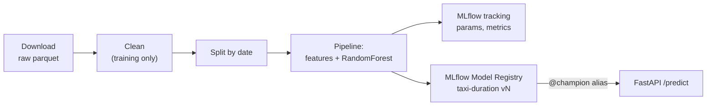

# NYC Yellow Taxi Trip Duration – Model Deployment Project

Predict the duration (in minutes) of NYC Yellow Taxi trips from January 2025, track experiments locally with MLflow, and serve predictions through a FastAPI app.

**Result:** the final `RandomForestRegressor` (max_depth 15) reaches a **validation RMSE of 4.17 minutes** on the last week of January 2025, 56% lower than a mean-prediction baseline (9.56 minutes).

> The original assignment template README is kept in [TEMPLATE_README.md](TEMPLATE_README.md); the brief is in [project-description.md](project-description.md).



## Project structure

| Path | Purpose |
|---|---|
| `config.yaml` | All settings: data period, paths, split cutoff, MLflow, model parameters |
| `src/config.py` | Loads `config.yaml`; builds file names/URLs from year and month |
| `src/download_files.py` | Downloads raw parquet files into `data/yellow_taxi/raw/` |
| `src/data.py` | `load_raw()`, `clean()`, `split_by_date()` |
| `src/features.py` | `prepare_features()`, shared by training and the API |
| `src/pipeline.py` | scikit-learn `Pipeline`: feature step + `RandomForestRegressor` |
| `src/model_io.py` | `TRUSTED_TYPES` for skops; optional local save/load helpers |
| `src/train.py` | Trains, logs params/metrics to MLflow, registers the pipeline as `taxi-duration` |
| `app/schema.py`, `app/main.py` | FastAPI schema and app; loads `models:/taxi-duration@champion` at startup |
| `notebooks/` | EDA (`1_eda`), analysis (`2_analysis`), model experiments (`3_model`) |
| `tests/` | pytest tests for config, cleaning, split, features, pipeline, model I/O and the API |
| `artifacts/` | Optional local model copies (git-ignored); not used for serving |

## Setup

Requires [uv](https://docs.astral.sh/uv/) and Python 3.13.

```bash
uv sync
source .venv/Scripts/activate      # Git Bash on Windows; macOS/Linux: source .venv/bin/activate
```

## How to run

All commands run from the project root.

```bash
# 1. Download the data (year/months from config.yaml, or pass -y / -m)
uv run python -m src.download_files

# 2. Start MLflow (terminal 1, keep running) -> http://127.0.0.1:5000
uv run mlflow server --host 127.0.0.1 --port 5000 --backend-store-uri sqlite:///mlflow.db

# 3. Train and register (terminal 2); parameters from config.yaml, overrides via options
uv run python -m src.train
uv run python -m src.train --max-depth 20 --run-name rf-depth20

# 4. Promote the chosen version to @champion
#    UI: Model registry -> taxi-duration -> Version N -> Aliases -> "champion"
#    or: python -c "import mlflow; mlflow.set_tracking_uri('http://127.0.0.1:5000'); mlflow.MlflowClient().set_registered_model_alias('taxi-duration', 'champion', N)"

# 5. Run the tests (no MLflow server needed)
uv run pytest -v

# 6. Serve the model (terminal 3, MLflow must be running) -> docs at http://127.0.0.1:8000/docs
uv run uvicorn app.main:app --reload --port 8000

# 7. Send a request
curl -X POST http://127.0.0.1:8000/predict \
  -H "Content-Type: application/json" -d @sample-request.json
```

Use `uv run ...` (or activate `.venv` first); otherwise `uvicorn`/`mlflow` are not found in a new terminal.

Example request ([sample-request.json](sample-request.json)):

```json
{"tpep_pickup_datetime": "2025-02-15T08:30:00", "PULocationID": 161, "DOLocationID": 236, "trip_distance": 2.4}
```

Response shape (`model_version` names the registry version that answered):

```json
{"duration_minutes": 12.22, "model_version": "taxi-duration v3 (champion, run 1803d1a6)"}
```

Invalid input (e.g. `trip_distance <= 0`, unknown zone ID, malformed date) returns HTTP 422. `GET /health` reports whether the model is loaded and which version is served. To switch models, move the `@champion` alias and restart the API.

## Data cleaning

Target: `duration = tpep_dropoff_datetime - tpep_pickup_datetime`, in minutes. Cleaning is applied to training/validation data only; the API cannot filter on duration.

| Rule | Finding | Decision |
|---|---|---|
| Pickups in January 2025 only | 22 rows (0.0006%) at the month borders (Dec 31 / Feb 1) | Removed so the dataset covers January 2025 pickups only |
| `total_amount >= 0` | Negative amounts are refunds / voided-trip reversals | Removed (used as a data-quality filter, not as a feature) |
| Duration 1–60 min | Negative, zero and multi-hour durations exist; 0.0326% exceed 500 min, mostly meter/clock errors | Kept 1–60 min |
| `trip_distance > 0` | 63,476 trips (1.9%) had 0 distance but normal durations (median 14.2 min, IQR 9–20 min): distance not recorded | Removed to keep the distance feature reliable |
| Duplicates | | Dropped |

Rows remaining after cleaning: _fill in from your run_.

## Features

| Feature | Source | Why |
|---|---|---|
| `PULocationID`, `DOLocationID` | Raw | Location strongly affects speed (Manhattan, airports) |
| `trip_distance` | Raw | Strongest driver of duration |
| `pickup_hour` | Pickup timestamp | Rush-hour traffic |
| `pickup_dow` | Pickup timestamp | Weekday vs weekend patterns |

**Excluded:** `fare_amount`, `tip_amount`, `total_amount` and other amounts are computed after the trip (leakage). `passenger_count` was dropped (little effect, missing and zero values).

Feature engineering and the model live in one scikit-learn `Pipeline`, so the API sends raw trip fields and gets exactly the same features as training.

## Validation strategy

Time-based split: **train on Jan 1–24, validate on Jan 25–31** (cutoff in `config.yaml`). This mimics predicting future trips and avoids the optimistic scores of a random split, where trips from the same day appear in both sets.

Weekly check for month-end effects:

| ISO week | Dates | Trips | Median duration (min) |
|---|---|---|---|
| 1 | Jan 1–5 (incl. New Year) | 429,557 | 11.88 |
| 2 | Jan 6–12 | 737,110 | 11.37 |
| 3 | Jan 13–19 | 831,996 | 11.62 |
| 4 | Jan 20–26 (incl. MLK Day) | 827,907 | 11.77 |
| 5 | Jan 27–31 (weekdays only) | 585,473 | 12.15 |

Medians are stable (11.4–12.2 min); lower counts in weeks 1 and 5 are partial weeks. No month-end effect, so the cutoff is appropriate.

The model is trained on a random sample of 500,000 rows from the training period (`split.train_sample`) to keep training fast; validation uses the full last week.

## Experiment tracking

Each run logs to MLflow (experiment `nyc-taxi-duration`):

- **Parameters:** model parameters, train/validation rows, cutoff, feature list
- **Metrics:** `val_rmse`, `val_mae`, `val_r2`, `train_rmse`, `baseline_rmse`, `train_seconds`, `predict_ms_per_row`, `model_size_mb`
- **Tags:** `stage`, `model_type`
- **Model:** the full pipeline (skops format), registered as a new version of `taxi-duration`; `model_size_mb` is read from the registry (`list_logged_model_artifacts`)

## Model registry and serving

The API does not load a local file. Training registers every model as a new version of **`taxi-duration`** in the MLflow Model Registry, and the API loads whichever version carries the **`@champion`** alias:

```python
mlflow.sklearn.load_model("models:/taxi-duration@champion")
```

Why the registry instead of a local `artifacts/model.skops` file:

| Reason | Registry | Local file |
|---|---|---|
| Stable reference for the API | `models:/taxi-duration@champion` never changes | Path must be updated or the file overwritten |
| Promote / roll back | Move the alias, restart the API | Copy or retrain files by hand |
| Traceability | Every version links to its run, params and metrics; the API returns the version in each response | Only by convention (e.g. a run-id text file) |
| History | All versions kept | Overwritten on each training run |
| Separation of training and deployment | Training only registers; choosing what is live is a separate, explicit step | Training directly replaces the served model |

Trade-offs: the MLflow server must be running before the API starts (startup fails with a clear message otherwise), and MLflow stores `model.skops` uncompressed, so the registry copy is larger than a compressed local file. 

## Why not MLflow autolog

`mlflow.sklearn.autolog()` was evaluated and not used. Tested with this pipeline (MLflow 3.18):

- **It only records training-set metrics.** It logs `training_root_mean_squared_error`, `training_r2_score` etc., which are optimistic (R² ≈ 0.999 on training data in a test). The metrics that matter here (`val_rmse`, `val_mae`, `val_r2`, `baseline_rmse`) must be logged manually anyway.
- **It saves the model with pickle by default**, which can execute arbitrary code when loaded; MLflow itself warns about this.
- **It cannot use skops for this model.** With `serialization_format="skops"`, model logging fails because the RandomForest trees and the custom `prepare_features` function are untrusted types, and autolog has no `skops_trusted_types` option.
- **No cost metrics or registry control.** `train_seconds`, `predict_ms_per_row`, `model_size_mb` and registration under a chosen name still need manual code.
- **Noisier runs.** It logs 30+ pipeline parameters with `model__`/`features__` prefixes, making run comparison harder to read.

Because the important logging must be manual regardless, explicit `log_params` / `log_metrics` / `log_model(..., skops_trusted_types=...)` was kept. A possible middle ground is `autolog(log_models=False)` to capture every estimator parameter as a safety net.

## Results

| Run | Registry version | max_depth | val RMSE | val MAE | val R² | train RMSE | Train time | Registry size |
|---|---|---|---|---|---|---|---|---|
| Baseline (predict mean) | – | – | 9.562 | – | – | – | – | – |
| **RF depth 15 (final, `@champion`)** | **v3** | 15 | **4.170** | 2.786 | 0.810 | 3.858 | 14.9 s | 159.7 MB |
| RF depth 20 | v2 | 20 | 4.086 | 2.720 | 0.817 | 3.351 | 18.9 s | 506.7 MB |

All runs: 100 trees, `min_samples_leaf=5`, 500k training rows, same validation week. Prediction time is about 0.002–0.003 ms per row for both. Registry size is the uncompressed skops model stored by MLflow (`model_size_mb`); the same models were about 49 MB and 148 MB as compressed joblib files in earlier runs.

**Why depth 15:** depth 20 lowered RMSE by only 0.08 min (2%, about 5 seconds per trip) but made the registered model 3.2 times larger (160 → 507 MB), trained 27% slower, and more than doubled the train/validation gap (0.31 → 0.74), a sign of overfitting. The small gain is not worth a half-gigabyte artifact that the API downloads and holds in memory at startup.

**RMSE/MAE ≈ 1.5:** a subset of trips (likely long or airport trips) still has large errors.

## Hyperparameter tuning (GridSearchCV)

Tuning so far was done by hand: two runs that differ only in `max_depth` (see Results). Depth 20 lowered validation RMSE by 2% (4.17 → 4.09 min) but made the registered model 3.2 times larger (160 → 507 MB) and overfit more. **The extra complexity was not worth it**, so depth 15 stays as `@champion`.

A systematic search with scikit-learn's `GridSearchCV` would work like this:

| Setting | Choice | Why |
|---|---|---|
| Parameters searched | `max_depth`: 10, 15, 20 × `min_samples_leaf`: 5, 20, 50 (9 combinations) | Depth drives accuracy and size; a larger leaf size caps the number of leaves, so it can keep depth-20 accuracy at a smaller size |
| Fixed | `n_estimators=100`, same features, same cleaning | Change only what is being tuned |
| Cross-validation | `TimeSeriesSplit(n_splits=3)` on the **training period only** (Jan 1–24), rows sorted by pickup time | Each fold trains on earlier trips and validates on later ones; the Jan 25–31 week stays unseen, so tuned and baseline scores are comparable |
| Scoring | `neg_root_mean_squared_error` | Same metric as the project |
| Search sample | ~150k rows | 27 fits (9 × 3 folds) stay within minutes |
| Final model | Refit the best combination on the same 500k sample as `train.py`; evaluate on the validation week | Fair comparison with the baseline run |
| Tracking | One MLflow parent run with a child run per combination (`cv_rmse_mean`, fit time) | Compare combinations in the MLflow UI |

```python
from sklearn.model_selection import GridSearchCV, TimeSeriesSplit

search = GridSearchCV(
    build_pipeline({"n_estimators": 100, "random_state": 42, "n_jobs": 1}),
    param_grid={"model__max_depth": [10, 15, 20], "model__min_samples_leaf": [5, 20, 50]},
    cv=TimeSeriesSplit(n_splits=3),
    scoring="neg_root_mean_squared_error",
    n_jobs=-1,
)
search.fit(X_tune.sort_values("tpep_pickup_datetime"), y_tune)   # training period only
```

**How the result would be judged:** the tuned model is worth promoting to `@champion` only if its validation RMSE beats 4.17 minutes by more than about 1–2% **and** its registered size is not much larger than 160 MB. Trading a small accuracy gain for a much larger model is exactly what the depth 15 vs 20 comparison rejected.

## Answers to the project questions

**1. What is the RMSE of the final model?**
**4.17 minutes** on the validation week (Jan 25–31, 2025), for the final model `taxi-duration` v3 (RandomForest, max_depth 15, served as `@champion`). That is 56% lower than always predicting the mean (9.56 minutes). MAE is 2.79 minutes and R² is 0.81. A deeper model (max_depth 20) reached 4.09 minutes but was 3.2 times larger (507 MB vs 160 MB), so it was not chosen.

**2. What would you do differently with more time?**

- Error analysis by trip length, zone and hour; add an airport flag, borough, zone-pair features and holiday/weather data.
- Run the GridSearchCV search described above (or Optuna for larger search spaces) and compare the tuned model with the depth-15 champion.
- Try gradient boosting (LightGBM / HistGradientBoosting): usually more accurate and much smaller than a random forest.
- Train on several months and test on a later month (e.g. February 2025) as an out-of-time check.
- Reduce model size and API startup time (higher `min_samples_leaf`, fewer trees, or a smaller model family) and compare the RMSE cost in MLflow.
- Automate promotion (set `@champion` only if a new version beats the current one on `val_rmse` within a size budget); let the API reload the model without a restart.
- Package the API and MLflow in Docker (docker compose); add CI to run the tests.

## Design decisions and trade-offs

- **Config-driven:** all settings in `config.yaml`; `load_config()` is called at run time so edits are always picked up.
- **skops instead of pickle/joblib:** the model is logged with an explicit `TRUSTED_TYPES` list (`src/model_io.py`), so loading cannot run arbitrary code.
- **Model Registry with an alias** decouples training from deployment (see "Model registry and serving").
- **Manual MLflow logging instead of autolog** (see "Why not MLflow autolog").
- **Filtering on the target** (1–60 min) removes invalid labels but means the reported RMSE covers in-scope trips only; very long real trips will be underpredicted.
- **API validation mirrors training:** zone IDs 1–265 and `trip_distance > 0` are enforced in the request schema.
